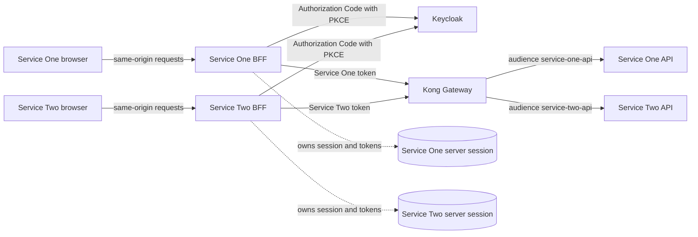
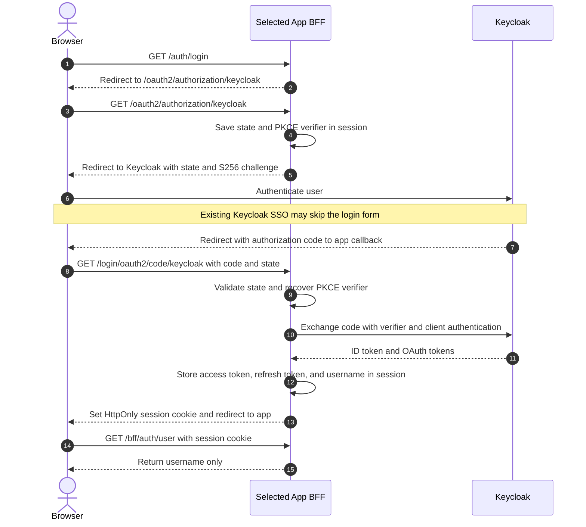
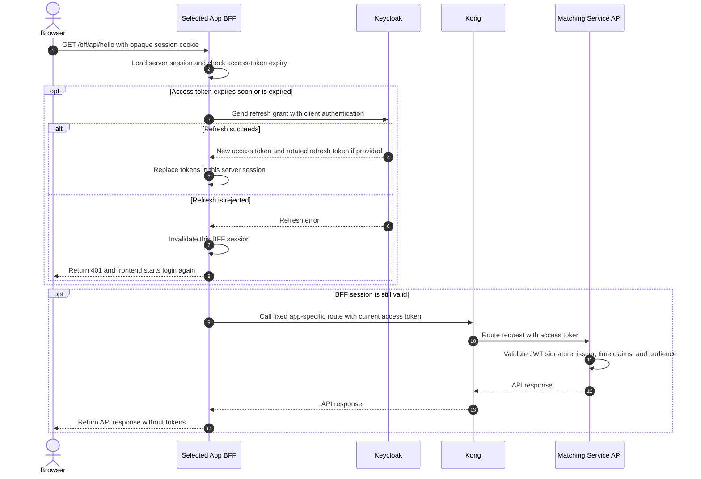
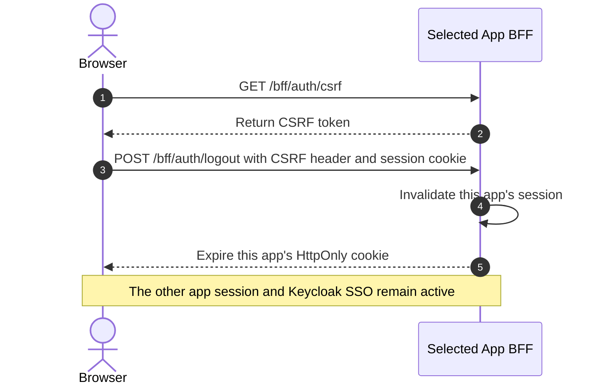

# Keycloak BFF SSO Lab

This local development stack contains two React applications, two Spring Boot BFF/API services, Kong Gateway OSS, and Keycloak. Each BFF is an independent confidential OAuth client and owns its own browser session. Both OAuth clients use the same Keycloak realm, so Keycloak SSO can authenticate the user without sharing BFF sessions or tokens.

## Architecture



Each NGINX frontend routes its own `/auth/login`, `/oauth2/**`, `/login/oauth2/**`, and `/bff/**` requests to its matching backend. The browser sends that app's opaque session cookie; the BFF stores access and refresh tokens in its server-side HTTP session. Both BFFs are confidential clients in the same Keycloak realm, but have separate OAuth clients and API audiences. There is no shared Auth Service or browser-facing bearer-ticket handoff.

## Login flow



Service One and Service Two use separate Keycloak clients and redirect URIs. The first login establishes Keycloak SSO; the other app still completes its own authorization flow and receives its own BFF session and client-specific API token. OAuth callback and authorization routes have NGINX access logging disabled.

## Protected API and refresh flow



The BFF maps only its own fixed routes to Kong; it is not a general-purpose URL proxy. Kong routes traffic without custom authentication plugins. Each API independently validates the JWT signature, issuer, time claims, and its service-specific audience (`service-one-api` or `service-two-api`).

## App-local logout flow



Logout is intentionally app-local. It does not revoke tokens or end the Keycloak SSO session.

## Run locally

```sh
docker compose up --build
```

Open [Service One](http://localhost:5173) or [Service Two](http://localhost:5174). Use the imported development account:

- Username: `testuser`
- Password: `testpassword`

Keycloak is available at [http://localhost:8080](http://localhost:8080) with local-only admin credentials `admin` / `admin`. The realm and demo credentials are imported only for this development stack. Published ports are bound to loopback; do not expose this Compose setup to a network.

Stop with `Ctrl+C`, or run `docker compose down`.

## Security and deployment notes

- Each BFF initiates and completes its own Authorization Code flow as a confidential client, uses PKCE, and relies on Spring Security's state validation. Each app has a separate Keycloak client and API audience; the same Keycloak realm supplies SSO.
- Access and refresh tokens are held only in the BFF's in-memory HTTP session. Browsers receive opaque, HttpOnly session cookies and never receive OAuth tokens. Refresh uses client authentication, stores a rotated refresh token when supplied, and invalidates the session when Keycloak rejects refresh.
- BFF session cookies are Secure by default, HttpOnly, host-only, Path `/`, and use the `__Host-Http-` prefix in HTTPS deployments. SameSite is `Lax` so the top-level GET callback from Keycloak can carry the pre-authentication session cookie required to validate OAuth state. CSRF protection is enabled for state-changing BFF requests; the separate CSRF token cookie is intentionally readable by the frontend.
- Compose overrides `Secure` and uses distinct unprefixed cookie names because local HTTP cannot use Secure cookies and both apps share `localhost`. This exception is local-only. Production must use HTTPS end-to-end, Secure cookies, production-mode Keycloak, managed secrets, and exact HTTPS redirect URIs.
- The Compose realm contains sample client secrets, admin credentials, and a sample user password. Replace them with managed secrets and production identity-provider configuration before deployment.
- The imported realm allows HTTP for loopback development but requires HTTPS for external clients. Production Keycloak deployments should set the realm's SSL requirement to `all` and use HTTPS for all client and token-endpoint traffic.
- Sessions are in process memory; the Compose BFF services have fixed container names to prevent accidental scaling beyond one replica. Restarting a backend logs out its users. Do not remove that single-instance constraint until Spring Session or another secured shared session store is configured and token data is protected at rest. The session idle timeout must not exceed the Keycloak refresh/session lifetime.
- Logging out invalidates only the selected app's BFF session. It does not revoke the Keycloak tokens or terminate Keycloak SSO, so a later login may immediately reuse SSO. Implement token revocation and RP-Initiated Logout only if global logout is required.
- NGINX access logging is disabled on OAuth authorization and callback paths so state, authorization codes, and other query values are not written to ordinary access logs. The callback and successful-login responses use no-store/no-referrer protections.
- This design follows the BFF guidance in [draft-ietf-oauth-browser-based-apps-17](https://datatracker.ietf.org/doc/html/draft-ietf-oauth-browser-based-apps-17), especially §§6.1.2–6.1.3. It is an expired Internet-Draft, not an RFC numbered 10017.
